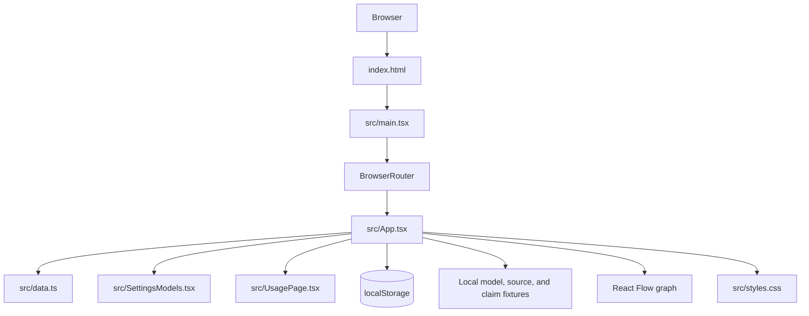
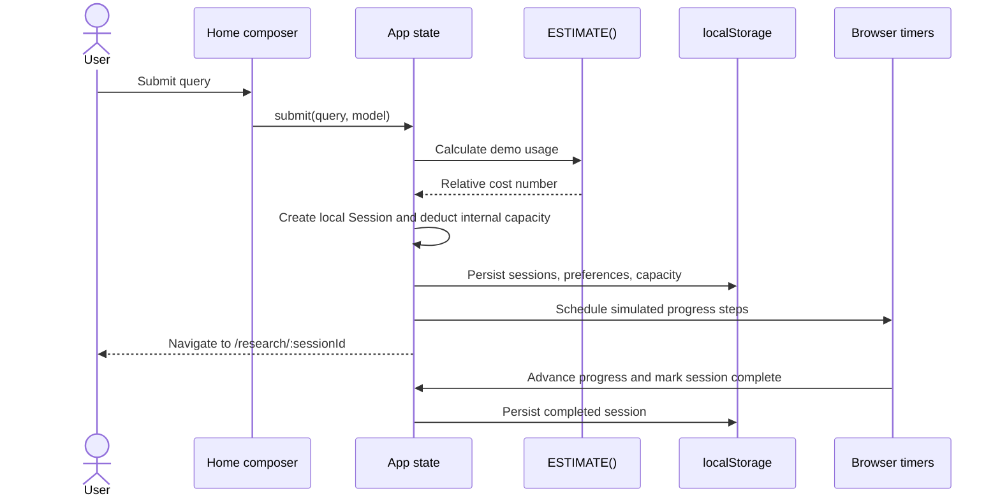

# Kairo Architecture

## 1. System overview

Kairo is a single-page React application built with Vite and TypeScript. The current system is browser-only and uses bundled TypeScript fixtures plus localStorage. It has no server, API layer, model provider, search provider, database, authentication, or billing service.



The diagram shows code boundaries, not remote services. The browser is the complete runtime for this prototype.

## 2. Runtime and dependencies

- **React 18** renders the application.
- **React Router 6** selects views from the URL.
- **Vite 6** provides development and production bundling.
- **TypeScript 5** checks application types under strict settings.
- **`@xyflow/react`** renders the interactive evidence graph.
- **Lucide React** supplies icons.
- **Vitest** is present for the small data-focused test suite.

The app entry point is `index.html` → `src/main.tsx`. `main.tsx` imports `src/styles.css` and React Flow's base stylesheet, mounts `<App />` in `React.StrictMode`, and wraps it in `BrowserRouter`. `vite.config.ts` enables the React plugin. There is no server-side rendering path.

## 3. Route and page architecture

The route table is defined in `src/App.tsx`.

| Path | View | Notes |
| --- | --- | --- |
| `/` | Research home | Composer, model picker, mode, estimate, simulated submission |
| `/research/:sessionId` | Research result | Answer, Sources, Claims, Graph tabs for the selected local session |
| `/library` | Research library | Searchable/filterable local session history |
| `/settings` | Preferences | Research defaults, appearance, demo data, product information |
| `/settings/models` | Model catalog | `SettingsModels` comparison and profile selection |
| `/settings/usage` | Usage history | `UsagePage` and demo capacity actions |
| `/graph/:sessionId` | Graph | Graph view for an existing selected session |
| `/models` | Redirect | Replaced with `/settings/models` |
| `/usage`, `/credits` | Redirect | Replaced with `/settings/usage` |
| Other | Not-found view | Recovery action returns to research home |

The top-level component owns app state and passes handlers/data to page and view components. `SettingsModels` and `UsagePage` are separate files; most other components currently live in `App.tsx`.

## 4. State ownership and data flow

### App-level state

`App` owns the state shared across routes:

- Session history and the active session ID.
- Composer query, selected model, research mode, and verification preference.
- Simulation busy/progress state and timer IDs.
- Current result tab and selected source/claim drawer.
- Toast, mobile sidebar, library search/filter, modal state, and internal demo capacity.
- Preferences, including reduced motion.

The active session is derived from `sessions` and `activeId`. Route changes to `/research/:sessionId` synchronize the active ID from the URL. Navigation helpers close the mobile navigation when needed.

### Research submission sequence



`submit` trims the query, rejects an empty query or an already-running run, calculates a demo estimate, and handles insufficient internal capacity. It creates an incomplete local `Session`, deducts the estimate, navigates to the result route, and schedules a finite series of timeouts based on research mode. The final timeout marks the session complete. No remote operation occurs. Canceling clears timers and refunds the demo amount; the investigation remains as a draft. The callbacks and timers are held in `App` and cleared when their flows complete or cancel.

### Preferences

Model, mode, and verification controls update top-level state and the `Preferences` object. The preference effect serializes to `kairo.preferences`. Reduced-motion preference controls a root class. The model picker effort slider is currently separate local UI state and does not enter this preference object.

### Local persistence

`src/data.ts` defines read helpers and defaults; `App.tsx` performs writes in effects. The storage keys are:

| Key | Contents | Default/fallback |
| --- | --- | --- |
| `kairo.sessions` | Session array | Starter fixture sessions when absent or unreadable |
| `kairo.preferences` | Model, mode, verification, motion preferences | `DEFAULT_PREFERENCES` |
| `kairo.credits` | Internal demo capacity number | `readCredits` fallback |

Writes are wrapped in `try/catch` because browser storage can be unavailable. Reset removes the keys and resets React state to demo defaults. Persisted data is client-side only and has no schema migration framework; changes to stored shapes should handle old entries safely.

## 5. Data model

The central fixture and type module is `src/data.ts`.

### Model profiles

`ModelId` is a union of the six IDs: `obsidian`, `opal`, `jade`, `garnet`, `topaz`, and `aventurine`. Each `MODELS` item contains a stable ID, display name, role, description, multiplier, visual tone, speed/depth metadata, and harness tags. These fields support the picker and settings catalog. They do not connect to model APIs or measure real performance.

The current estimate is an arithmetic function:

```text
ceil(mode base × model multiplier + optional verification increment)
```

Mode bases are 4 for Quick answer, 11 for Research, and 20 for Deep research; verification adds 3. The result is an internal demo usage unit. Avoid naming it a real cost or provider credit charge in product copy.

### Sessions

A `Session` carries its ID, title, query, model ID, mode, display date, estimated demo usage, saved/completed state, and whether verification was selected. It is enough to render the local history and results; it is not a job handle or record of a remote execution.

### Sources and claims

Five source fixtures (`S1`–`S5`) and three claim fixtures (`C1`–`C3`) provide static evidence data. Claims reference sources by ID and carry a status. Result tabs, citations, drawers, and graph edges derive from these fixtures. There is no parser, crawler, citation resolver, or verification engine behind them.

## 6. Main UI areas

### Composer and model picker

The home composer is implemented in `App.tsx`. It combines the auto-growing query textarea, plus attachment affordance, model selector, research mode control, and submit/cancel action. Model selection opens a local popover; it does not navigate to the model catalog. The effort slider is currently visual/local state and is not part of the estimate. The attachment affordance does not ingest files.

### Research results

`ResearchPage` displays session metadata and tabs for Answer, Sources, Claims, and Graph. The removed Investigation panel is not part of the current page architecture. Result output is fixture-based explanatory content. Source and claim selection opens a detail drawer; citations link to source details. Saving and library operations update local session state.

### Settings and library

`SettingsPage` switches among preferences, model catalog, and usage through its settings tabs. `SettingsModels.tsx` renders the profile comparison and calls the shared model update handler. `UsagePage.tsx` derives completed-session history from session props. `LibraryPage` operates on the app-owned sessions via callbacks.

### Evidence graph

`GraphPage` builds question, claim, and source nodes from fixture data and connects them with static edges. Contradiction styling/labels are derived from claim status and the source relation. React Flow is controlled with `useNodesState(baseNodes)` and `onNodesChange`; this is required for node drag positions to update and remain stable through renders during the component lifetime.

Graph behavior includes:

- Dragging nodes to arrange the canvas; pan by dragging empty canvas space.
- Search and type filters; edges are restricted to those whose endpoints remain visible.
- Claim selection opens the claim drawer.
- Fullscreen toggling via the browser Fullscreen API, with a `fullscreenchange` listener to keep the button state current.
- Memo creation as a custom node type. Memo text is editable; textarea events are prevented from becoming graph drag/scroll gestures. A top-right delete control removes that memo.
- No React Flow Controls or MiniMap in the current graph UI.

Graph nodes and memos live in `GraphPage` component state only. They are not serialized into `Session` or localStorage, so moving nodes or adding notes is temporary across navigation/remounts. Graph layout is not produced by an automatic layout engine.

## 7. Styling and responsive layout

`src/styles.css` contains the application theme, component styling, and responsive rules. The design is a dark graphite/monochrome interface with semantic status treatments. Most styles are class based. Breakpoints currently cover wide desktop through narrow mobile layouts. The stylesheet is compact and includes later overrides; CSS changes should be checked against the full cascade and the affected responsive variants.

`index.html` does not import remote font files. CSS font stacks therefore depend on installed fonts and fallbacks; the original design brief's named font choices are not guaranteed at runtime. React Flow base CSS is imported separately by `main.tsx`.

## 8. External boundaries

There are intentionally no adapters for external services. Current user-visible simulation boundaries:

- Model selection affects fixture metadata and estimated demo usage only.
- A research run advances with browser timers and local data.
- Evidence verification is represented by preference and static claim status.
- Usage history summarizes local session records.
- Capacity is a local demo number.
- The attachment button is only a UI affordance.

Adding any live provider or search integration would change the security, privacy, error-handling, and architecture assumptions. It requires an explicit product request and a separate design of credentials, data flow, source provenance, and failure states.

## 9. Build and tests

Project scripts in `package.json`:

- `npm run dev` — Vite development server.
- `npm run build` — TypeScript build followed by Vite production bundle.
- `npm run preview` — local preview of the bundle.
- `npm test` — Vitest once.

`src/data.test.ts` covers three data-level concerns: estimator scaling for deeper/verified research, valid claim-to-source references, and distinct profiles with positive multipliers and harness data. These tests do not exercise browser interactions, routing, React Flow dragging, visual layout, or actual model/search behavior.
