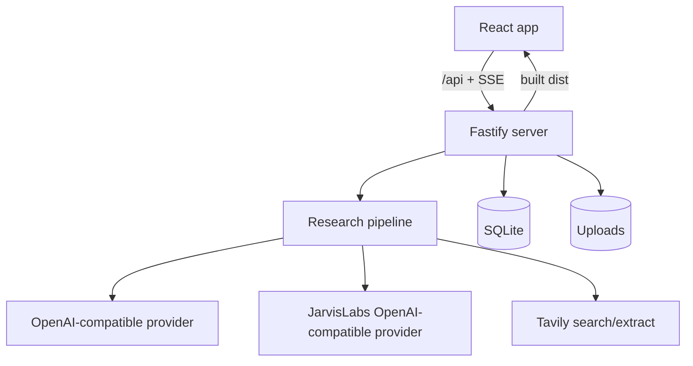
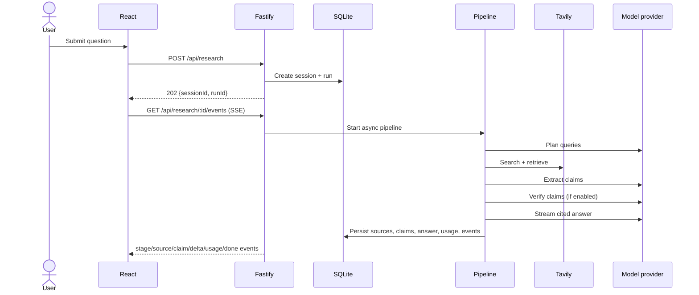

# Kairo Architecture

## 1. System overview

Kairo is a single-user web application with a React/Vite frontend, a Fastify/TypeScript API, SQLite persistence, and two external OpenAI-compatible model providers plus Tavily search. One process serves both the API and the built frontend in production.

## 2. Runtime and dependencies

Frontend:

- React 18, React Router 7, Vite 6, TypeScript
- `@xyflow/react` for the graph
- `lucide-react` icons
- `react-markdown` + `remark-gfm` for cited answers

Server:

- Fastify 5 with `@fastify/static` and `@fastify/multipart`
- `better-sqlite3` with WAL mode and foreign keys
- `openai` SDK using a per-provider `baseURL`
- Tavily REST API via `fetch`
- `unpdf` for PDF text extraction
- `zod` for request and structured-output validation
- `tsx` to run TypeScript directly
- Vitest for tests

`shared/models.ts` and `shared/types.ts` are imported by both sides so model IDs, modes, DTOs, and SSE events stay aligned.

## 3. Route architecture

| Path | View | Notes |
| --- | --- | --- |
| `/` | Research home | Composer, real submit, attachments |
| `/research/:sessionId` | Research result | SSE progress, answer, sources, claims, graph |
| `/library` | Research library | Server-backed history and actions |
| `/settings` | Preferences | Defaults, appearance, reset |
| `/settings/models` | Model catalog | Profile-to-provider routes |
| `/settings/usage` | Usage | Token counts and runs |
| `/graph/:sessionId` | Graph | Standalone graph view |
| `/share/:token` | Public share | Frozen snapshot, no workspace shell |
| `/models`, `/usage`, `/credits` | Redirects | Settings equivalents |
| Other | Not found | Recovery link |

`src/App.tsx` owns the shell, routes, bootstrap state, preferences, session list, and page composition. `SettingsModels.tsx` and `UsagePage.tsx` are separate settings views. `src/api.ts` is the typed client and SSE subscriber.

## 4. Bootstrap and state flow

On load the frontend fetches in parallel:

- `GET /api/config`
- `GET /api/preferences`
- `GET /api/models`
- `GET /api/sessions`

If no model route or Tavily key is configured, the app shows the setup screen instead of the workspace. If the stored preference points to an unavailable profile, the client selects the first available profile and persists it.

Research submission:

SSE events are persisted in the `events` table. Reconnecting clients replay from `Last-Event-ID`, then receive live events. A heartbeat keeps intermediaries from closing idle streams.

## 5. Persistence

SQLite schema:

| Table | Contents |
| --- | --- |
| `sessions` | Question, title, model/mode/effort, verification flag, status, answer, timestamps, parent |
| `runs` | Provider/model route, stage, status, token totals, search count, error |
| `stage_usage` | Prompt/completion tokens, estimate flag, duration per stage |
| `sources` | Stable `S1…Sn` IDs, URL or upload, title, domain, kind, excerpt, content, relevance, relationship |
| `claims` | Stable `C1…Cn` IDs, text, status, detail, source IDs, source-claim relations |
| `events` | Run event sequence for SSE replay |
| `graph_layout` | Per-session node positions |
| `graph_memos` | Per-session memo text and positions |
| `attachments` | Uploaded file metadata, disk path, extracted text |
| `session_attachments` | Session-to-attachment links |
| `preferences` | Single row: model, mode, verification, reduced motion, effort |
| `shares` | Tokenized frozen snapshots |

The database path defaults to `data/kairo.db`; uploads default to `data/uploads`. Both are configurable through `DATA_DIR`. Writes are synchronous within the server process. At startup, runs left `queued`/`running` by a previous process are marked failed.

## 6. API surface

Config and catalog:

- `GET /api/health`
- `GET /api/config` — setup state and missing variable names, never secrets
- `GET /api/models` — six profiles with provider/model/availability

Research:

- `POST /api/research` — create and start a run
- `GET /api/research/:sessionId/events` — SSE with replay
- `POST /api/research/:sessionId/cancel`
- `POST /api/research/:sessionId/rerun`
- `POST /api/research/:sessionId/followup`

Sessions and preferences:

- `GET /api/sessions`, `GET /api/sessions/:id`
- `PATCH /api/sessions/:id` (title, saved)
- `DELETE /api/sessions/:id`
- `GET|PUT /api/preferences`
- `GET /api/usage`
- `POST /api/reset`

Graph, attachments, export, share:

- `GET|PUT /api/sessions/:id/graph`
- `POST /api/sessions/:id/graph/reset`
- `POST /api/attachments`, `DELETE /api/attachments/:id`
- `GET /api/sessions/:id/export?format=md|json`
- `POST /api/sessions/:id/share`
- `DELETE /api/sessions/:id/share/:token`
- `GET /api/share/:token` (public)

Request validation uses Zod. Errors share a JSON shape: `{ error: { message, code } }`.

## 7. Research pipeline

Implementation: `server/src/research/pipeline.ts`.

Stage sequence:

1. **Planning** — model produces JSON search queries. Invalid JSON is repaired once, then falls back to the user question.
2. **Searching** — Tavily search per query. Results are deduplicated by URL and capped by mode.
3. **Extracting** — Tavily content is normalized; extraction is requested for results with too little content. Attachments become sources as well.
4. **Claims** — model returns JSON claims with source IDs and `supports`/`challenges`/`context` relations. Invalid source IDs are dropped.
5. **Verification** — when enabled, a second model pass assigns `Supported`, `Contradicted`, or `Insufficient evidence` per claim with a short rationale.
6. **Synthesis** — the model streams Markdown with `[S1]` citations. Invalid source markers are removed and a citation map is persisted.
7. **Finalizing** — token totals, status, sources, claims, answer, and graph data are saved; `usage` and `done` events are emitted.

Mode controls query count, source cap, source excerpt length, and answer source count. Effort controls answer tokens, temperature, and extra queries. Provider-reported usage is preferred; when a provider omits it, the server estimates tokens and marks the result as estimated.

Failures are persisted on the run/session and sent as an `error` event. Cancellation aborts provider requests through an `AbortController`, marks the run/session cancelled, and retains the draft session.

## 8. Provider routing

`server/src/config.ts` reads:

- `OPENAI_BASE_URL`, `OPENAI_API_KEY`
- `JARVISLABS_BASE_URL`, `JARVISLABS_API_KEY`
- `MODEL_<PROFILE>_PROVIDER`, `MODEL_<PROFILE>_NAME`
- optional JSON/stream-usage flags per provider

`OpenAiCompatibleGateway` caches one OpenAI SDK client per provider. A profile without a configured provider/key/model is exposed as unavailable and cannot be selected or used for a run. No secret is included in `/api/config` or `/api/models`.

## 9. Frontend behavior

- `src/api.ts` centralizes fetch, uploads, JSON errors, export URLs, and EventSource subscriptions.
- The composer uploads files immediately, shows removable chips, and sends attachment IDs with the run.
- The result page boots from `GET /api/sessions/:id`; if the run is active it subscribes to SSE. Stage events drive the activity panel; answer deltas render as a live preview. The finished answer is rendered with ReactMarkdown and clickable citations.
- Source and claim drawers use the run's real data. External links open in a new tab; relevance is explicitly distinguished from reliability.
- Graph state is controlled by `useNodesState`. Positions and memos are persisted through the graph API with a short debounce. Reset restores default layout. Share graphs are read-only.
- Settings update server preferences optimistically and reload preferences on failure.
- Usage fetches real token totals and per-model summaries.
- The shared page renders a frozen snapshot and has no workspace navigation or editing controls.

## 10. Security and reliability

- Secrets live only in server environment variables.
- Provider base URLs, API keys, and raw prompts are not exposed through the API.
- Uploads are size/MIME limited; PDF/text extraction is local.
- Tavily-supplied URLs are validated as HTTP(S) and excluded if they are local/private addresses before being stored or rendered.
- Source text is treated as untrusted in prompts; the system prompt tells the model to ignore instructions inside sources.
- Markdown rendering does not allow raw HTML; external links use `rel="noreferrer"`.
- Concurrency is capped (`MAX_CONCURRENT_RUNS`); provider timeouts and a small retry policy are configured through the OpenAI client.
- No authentication is implemented. Bind to loopback (default) or place the server behind an authenticated reverse proxy. Public share tokens are the only intentionally public data.
- SSE headers disable caching/buffering and include heartbeats; events are replayed from persisted storage.

## 11. Build, deployment, and tests

- `npm run dev` — Vite plus `tsx watch` API, with `/api` proxied to port 8787.
- `npm run build` — web `tsc -b`/Vite build and server `tsc --noEmit`.
- `npm start` — run the API with static serving of `dist/`.
- `docker compose up --build` — build both sides, serve from one container, persist `data/` in a volume.
- `npm test` — web model tests plus server integration tests.

Server tests use fake `LlmGateway` and `SearchProvider` implementations and an in-memory SQLite database. They cover configuration failure, the full pipeline, persistence, graph/share/export, CRUD, preferences, usage, and unavailable routes. They do not call live providers. Browser interaction, streaming under real network conditions, and provider-specific quirks still require a live smoke test with valid credentials.
